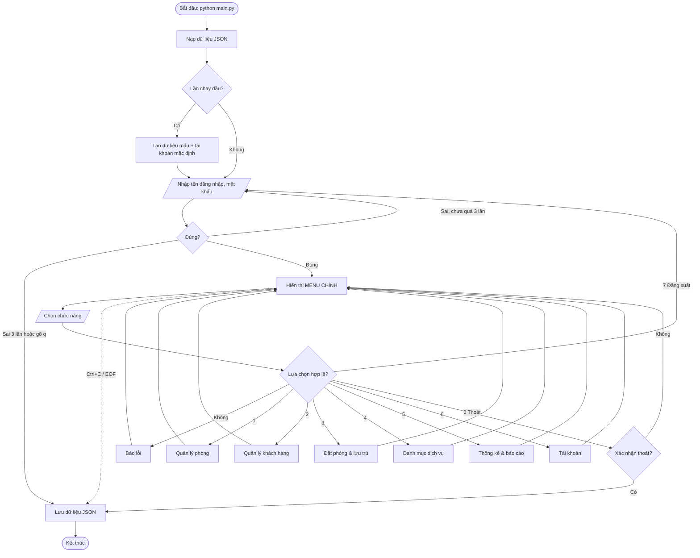
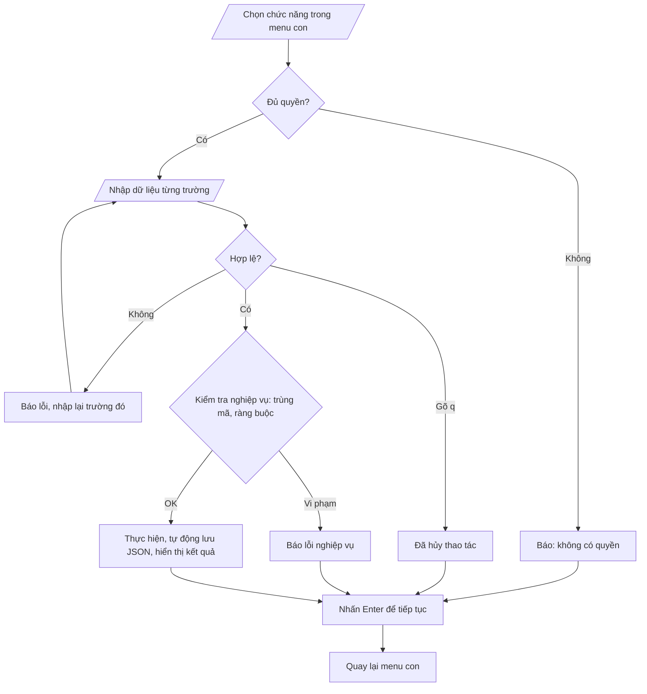
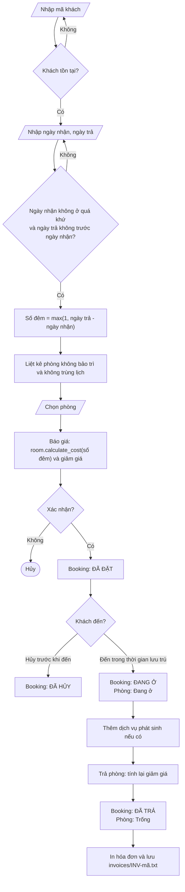
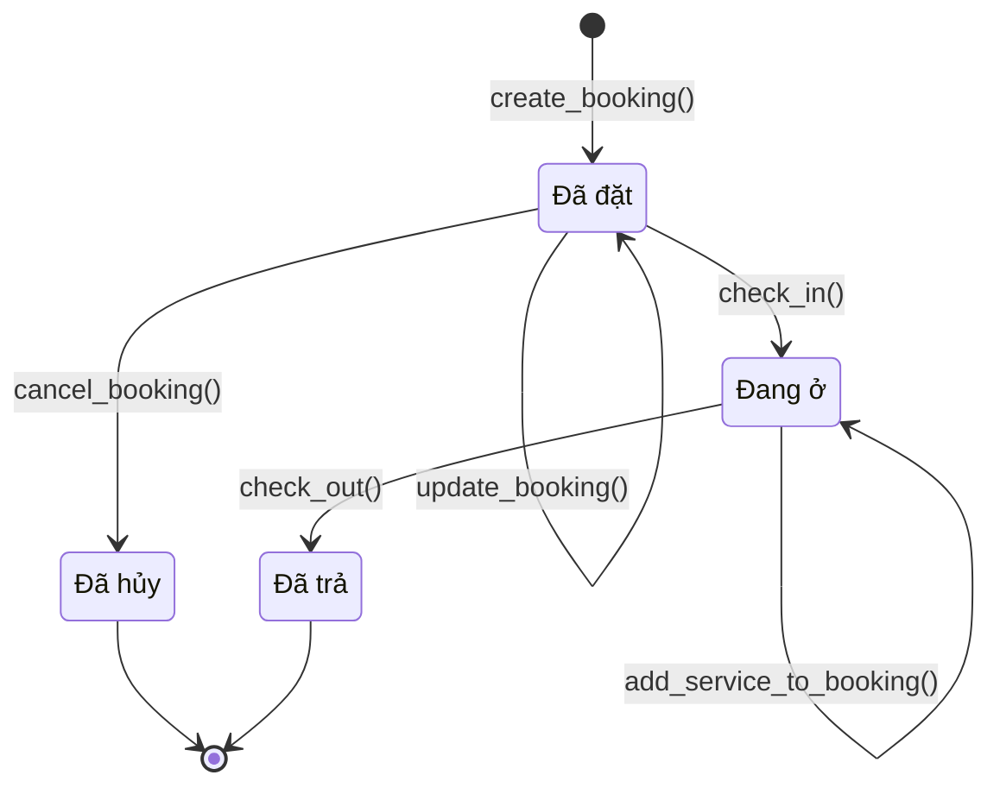

# Lưu đồ hoạt động – Menu chính và các nghiệp vụ

## 1. Luồng chương trình và menu chính

## 2. Xử lý một chức năng trong menu con

## 3. Nghiệp vụ đặt phòng – nhận phòng – trả phòng

## 4. Vòng đời trạng thái

Trạng thái phòng: `Trống ⇄ Bảo trì` (Admin đổi thủ công). `Trống → Đang ở` chỉ xảy ra khi nhận phòng; `Đang ở → Trống` chỉ xảy ra khi trả phòng.
