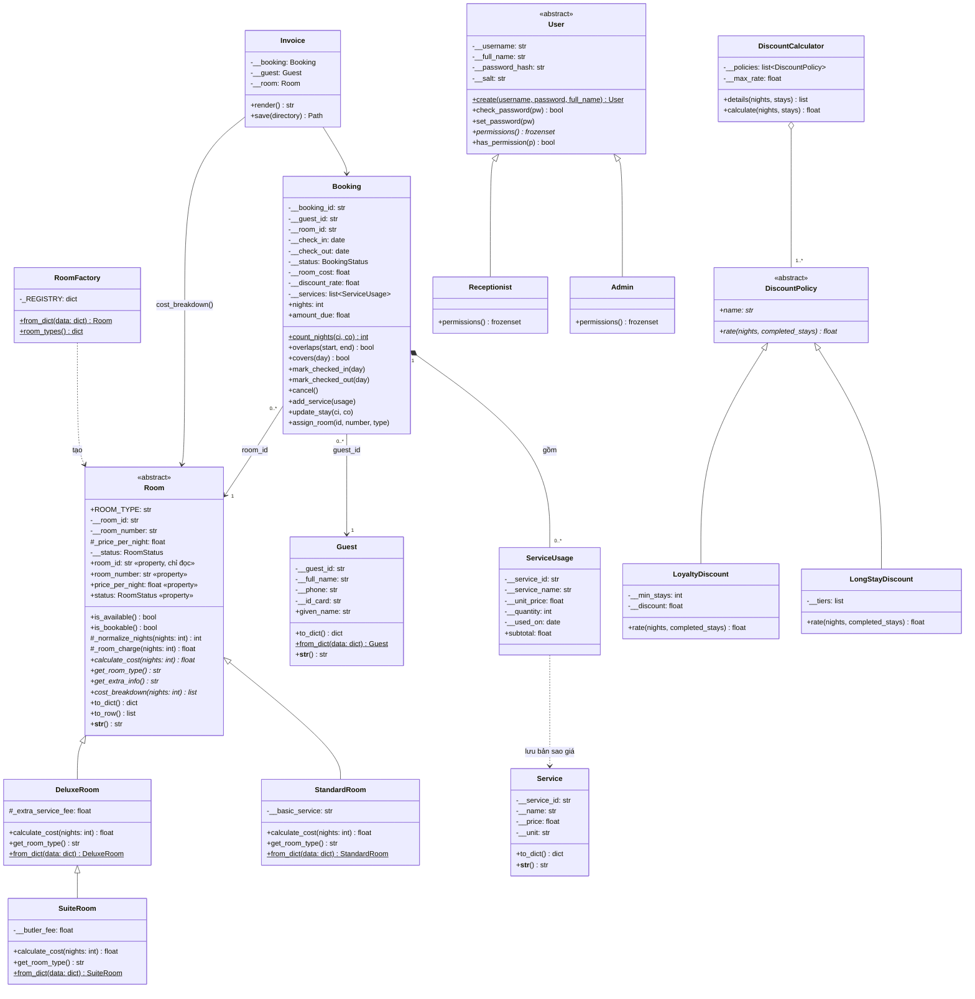
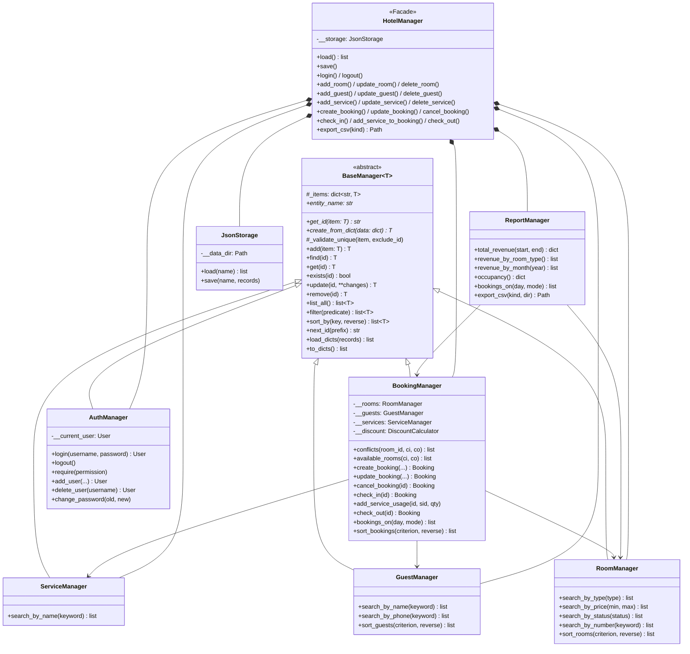
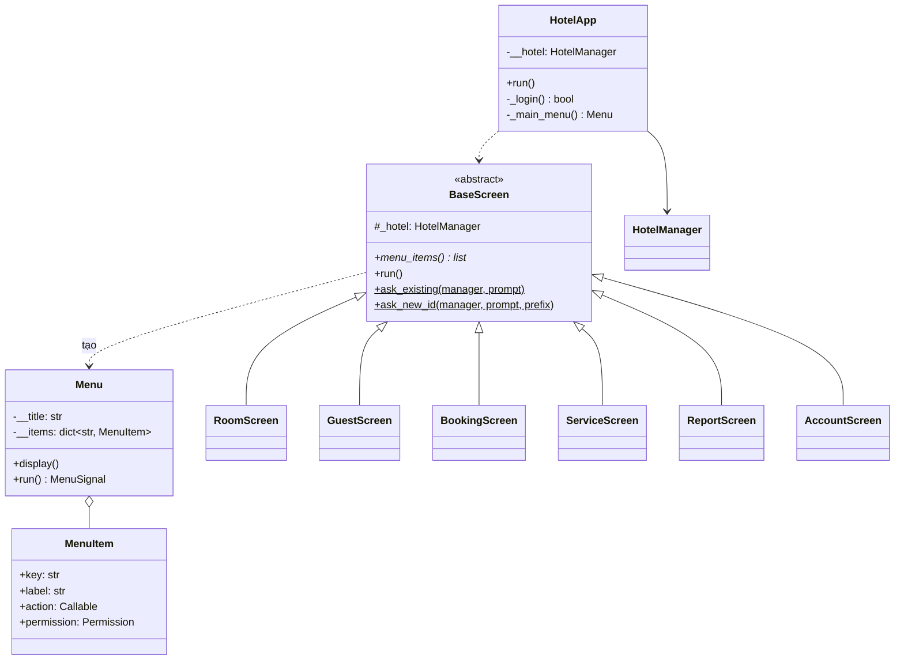

# Sơ đồ lớp UML – Hệ thống Quản lý Khách sạn

Ký hiệu phạm vi truy cập: `+` public · `-` private (`__thuoc_tinh`) · `#` protected (`_thuoc_tinh`).
Phương thức trừu tượng được đánh dấu `*`. Các thuộc tính private đều được truy cập qua `@property` (getter/setter có kiểm tra dữ liệu).

> Có thể xem sơ đồ trực tiếp trên GitHub/VS Code (Markdown Preview Mermaid), hoặc dán vào https://mermaid.live để xuất ảnh PNG/SVG.

## 1. Lớp thực thể (models)

## 2. Lớp quản lý (managers)

## 3. Tầng giao diện (ui)

## 4. Giải thích các quan hệ OOP

| Quan hệ | Ví dụ trong bài | Ý nghĩa |
|---|---|---|
| **Kế thừa** | `StandardRoom`, `DeluxeRoom` kế thừa `Room`; `SuiteRoom` kế thừa `DeluxeRoom` (nhiều cấp); `Admin`, `Receptionist` kế thừa `User`; 5 manager kế thừa `BaseManager`; 6 màn hình kế thừa `BaseScreen` | Dùng lại thuộc tính và phương thức chung, lớp con chỉ bổ sung phần riêng |
| **Đa hình (ghi đè)** | `calculate_cost()`, `get_room_type()`, `cost_breakdown()`, `__str__()` của các loại phòng; `permissions()` của các loại `User`; `rate()` của các chính sách giảm giá | Cùng một lời gọi nhưng mỗi lớp xử lý khác nhau. Ví dụ `Invoice` gọi `room.cost_breakdown()` mà không cần biết loại phòng |
| **Đóng gói** | Thuộc tính `__private` / `_protected` + `@property` có setter kiểm tra dữ liệu; `Booking` chỉ đổi trạng thái qua `mark_checked_in()`, `cancel()`… | Không thể gán dữ liệu sai hoặc nhảy cóc trạng thái |
| **Trừu tượng (ABC)** | `Room`, `User`, `DiscountPolicy`, `BaseManager`, `BaseScreen` | Bắt buộc lớp con cài đặt các phương thức trừu tượng; không tạo được đối tượng trực tiếp từ lớp trừu tượng |
| **Hợp thành** (◆ composition) | `Booking` ◆— `ServiceUsage`; `HotelManager` ◆— các manager | Thành phần tồn tại cùng vòng đời với lớp chứa nó |
| **Kết tập** (◇ aggregation) | `DiscountCalculator` ◇— `DiscountPolicy`; `Menu` ◇— `MenuItem` | Lớp chứa giữ tham chiếu tới các đối tượng có thể tồn tại độc lập |
| **Liên kết** (→ association) | `Booking` → `Guest`, `Room` (qua mã); `BookingManager` → `RoomManager` | Đối tượng này biết và dùng đối tượng kia |
| **Phụ thuộc** (⇢ dependency) | `RoomFactory` ⇢ `Room`; `ServiceUsage` ⇢ `Service` | Chỉ dùng tạm thời (tạo đối tượng, sao chép giá) |
| **Mẫu thiết kế** | Facade (`HotelManager`), Factory (`RoomFactory`, `UserFactory`), Strategy (`DiscountPolicy`), Template Method (`BaseManager.add` gọi hook `_validate_unique`) | Tách nghiệp vụ khỏi giao diện, dễ mở rộng thêm loại phòng hoặc chính sách mới |

### Vì sao điều chỉnh so với các lớp gợi ý của đề

- Bổ sung `SuiteRoom` (chức năng mở rộng), kế thừa từ `DeluxeRoom` để minh họa kế thừa nhiều cấp.
- Tách `HotelManager` thành nhiều manager chuyên trách; `HotelManager` chỉ đóng vai trò điều phối (Facade). Như vậy mỗi lớp chỉ có một nhiệm vụ.
- `Booking` lưu thêm trạng thái, tiền phòng, giảm giá và danh sách dịch vụ để phục vụ trả phòng, hóa đơn và thống kê. Đồng thời lưu số phòng và loại phòng tại thời điểm đặt, để lịch sử vẫn đúng khi phòng bị sửa hoặc xóa.
- `Guest` có thêm `id_card` (CCCD/hộ chiếu), không bắt buộc nhập nhưng phải duy nhất nếu có.
